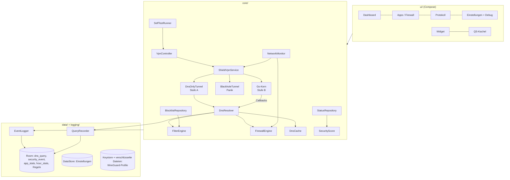
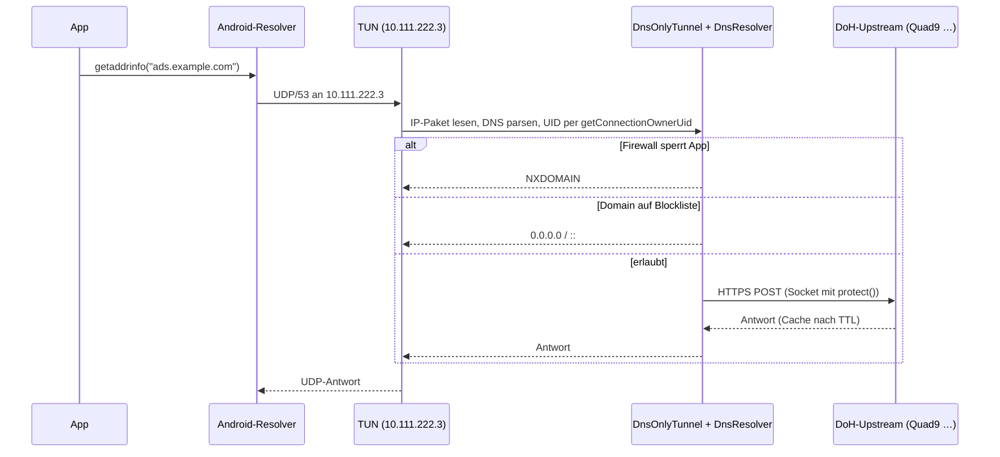

# Architektur

Shield besteht aus einer Android-App (Kotlin, Compose, Hilt, Room, DataStore, WorkManager) und einem
Go-Netzwerkkern (`gocore/`, per gomobile als AAR eingebunden). Android erlaubt nur **einen** aktiven
`VpnService` – Blocker, Firewall und WireGuard laufen deshalb alle durch `ShieldVpnService`.

## Schichten



## Netzwerk-Kern

### Stufe A – nur DNS durch den Tunnel (Standard)



* Routen: nur `10.111.222.3/32` und `fd00:5:1::3/128`, die gleichzeitig als System-DNS gesetzt werden.
* Der übrige Verkehr läuft direkt über das Netz – stabil und akkuschonend.
* Firewall: gesperrte Apps bekommen NXDOMAIN für alle Anfragen (Grenze: hartkodierte IPs, siehe SECURITY.md).

### Stufe B – voller Tunnel (Go-Kern)

```mermaid
flowchart LR
  TUN[TUN 0.0.0.0/0, ::/0] --> NS[gVisor netstack<br/>TCP/UDP-Forwarder]
  NS -->|Port 53, egal welche IP| DNS[DNS-Proxy] -->|FilterDns-Callback| KT[Kotlin DnsResolver]
  DNS -->|erlaubt| DOH[DoH-Client in Go]
  NS -->|neuer Flow| FWC{AllowFlow-Callback<br/>UID + Firewall}
  FWC -->|blockiert| DROP[RST / verwerfen]
  FWC -->|erlaubt, kein VPN| DIRECT[geschützter Socket<br/>VpnService.protect]
  FWC -->|erlaubt, VPN aktiv| WG[wireguard-go<br/>+ eigener netstack]
  WG --> UDP[UDP-Socket protect()] --> Server[(WireGuard-Server)]
  KS{Kill-Switch:<br/>VPN aktiv, aber kein Handshake} -.-> DROP
```

* Jeder neue TCP/UDP-Flow fragt per Callback die UID (`getConnectionOwnerUid`) und die Firewall-Regel ab.
* DNS wird für **jede** Ziel-IP auf Port 53 abgefangen, damit Apps den Filter nicht über eigene Resolver umgehen.
* Mit WireGuard laufen Flows und auch der DoH-Upstream durch den WireGuard-Tunnel; ohne WireGuard über geschützte Sockets.
* Kill-Switch: Ist ein Profil aktiv, aber der letzte Handshake älter als 3 Minuten, werden alle Nicht-DNS-Flows verworfen.
* Panik-Knopf: Der Tunnel wird als „Schwarzes Loch“ neu aufgebaut – alle Pakete werden verworfen, bis der Modus endet.

### Warum ein eigener Kern statt firestack?

firestack (RethinkDNS, MPL-2.0) ist eine gute Vorlage, aber sehr umfangreich
(Proxies, DNSCrypt, eigene UID-Logik). Shield nutzt dieselben Bausteine (wireguard-go + gVisor netstack)
mit einem kleinen, eigenen Go-Paket (`gocore/shieldcore`, ~800 Zeilen) und einer schmalen Callback-Schnittstelle
(`Bridge`), damit Filter-, Firewall- und Logging-Logik an einer Stelle in Kotlin bleiben und testbar sind.

## Filter-Engine

* Formate: hosts, reine Domainlisten, AdGuard-Basis-Syntax (`||domain^`, `@@||domain^`, `$important`).
  Regeln mit Pfaden oder nicht DNS-fähigen Modifikatoren (`$third-party`) werden übersprungen.
* Datenstruktur: Hash-Map `Domain → Liste` mit Suffix-Prüfung (pro Label ein Lookup, < 1 ms).
* Reihenfolge: eigene Erlaubt-Liste > eigene Blockliste > Ausnahmen der Listen > Abo-Listen > erlauben.
* Interne Test-Domain `selftest.shield.invalid` ist immer blockiert (Selbsttest Punkt 3).

## Selbsttest (SPEC §6)

1. VpnService läuft, TUN aktiv · 2. System-DNS zeigt auf die virtuelle Adresse (und kein „Privates DNS“ umgeht sie)
· 3. eindeutige Subdomain der Test-Domain wird über den echten Systempfad blockiert · 4. DoH-Upstream antwortet (Latenz)
· 5. Blocklisten geladen und < 48 h alt · 6. (mit WireGuard) Handshake < 3 Min; auf Knopfdruck zusätzlich IP ≠ Heim-IP, kein DNS-/IPv6-Leak.

Jeder Test erzeugt ein `security_event`. Periodisch (WorkManager, 15 Min) laufen nur lokale Tests.

## Daten

| Tabelle | Inhalt | Aufbewahrung (Standard) |
|---|---|---|
| `dns_query` | Zeit, UID, App, Domain, Typ, Ergebnis, Regel, Latenz | 7 Tage (oder gar nicht: „Kein Verlauf“) |
| `app_stats` | Anfragen/Blockiert pro App und Tag | 90 Tage |
| `hour_stats` | Zähler pro Stunde (Diagramm), ohne Domains | 90 Tage |
| `security_event` | Zeit, Typ, Schwere, Nachricht, Details-JSON | 30 Tage |
| `custom_rule`, `app_rule`, `homelab_tile`, `wg_profile` | Regeln, Kacheln, Profil-Metadaten | dauerhaft |

WireGuard-Konfigurationen (mit privatem Schlüssel) liegen AES-GCM-verschlüsselt in `noBackupFilesDir`,
der Schlüssel bleibt im Android Keystore.
